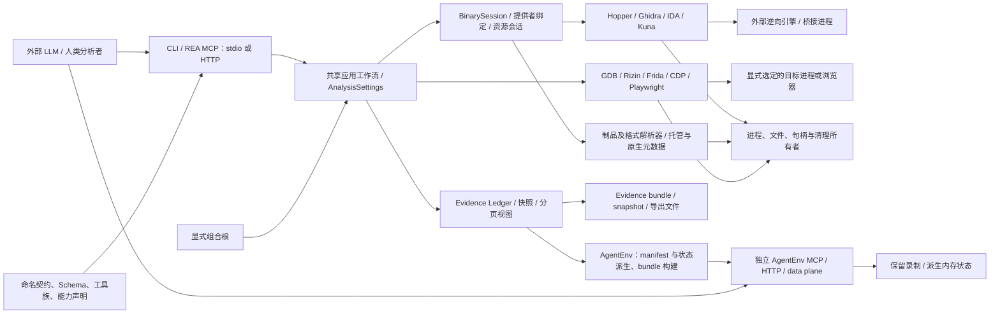
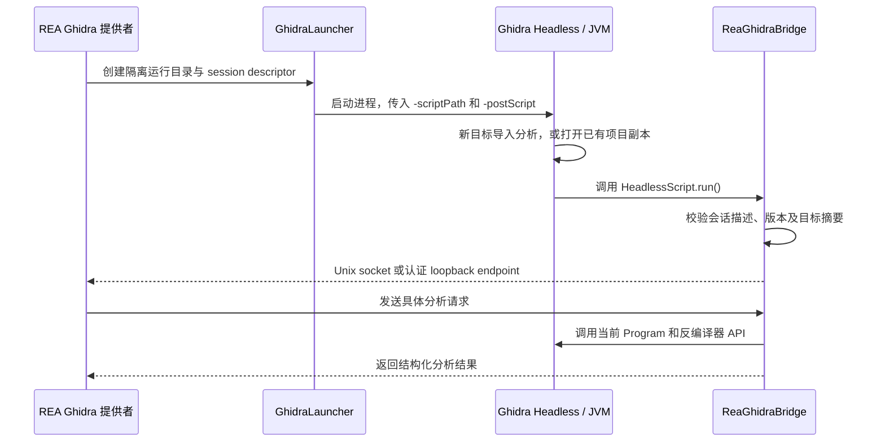

**REA 架构复评报告（中文）**

评审日期：2026-10-28。本文评估源码架构与验证证据，不包含功能实现或代码修改。

**一、版本、范围与证据等级**

| 项目 | 本次确认结果 |
| --- | --- |
| 上次评审基线 | `c7105d9723c835b5e0122f5fc6cfbea86265c349`，提交时间为 2026-10-14 01:34:02 UTC |
| 当前 HEAD / 本地 main | `64196b08cab9fab15649b6d0058f980cd3f733f6`，提交时间为 2026-10-28 15:18:22 UTC |
| 远端 main | 评审时以只读 `git ls-remote` 核验，上游 `morluto/rea` 和 origin `SeraYang/rea` 的 main 均指向上述 HEAD |
| 比较可行性 | 基线对象存在，且是 HEAD 的祖先；以下比较来自两个版本的实际源码 |
| 提交数量 | `git rev-list --count baseline..HEAD` 为 3,077；包含合并历史，不能当作独立功能数量 |
| 源码包版本 | 6.4.0 → 6.8.0；这是仓库版本，不是对 npm 当前发布状态的核验 |
| 全仓库差异 | 5,765 个文件，增加 1,195,290 行、删除 162,224 行；包含文档、翻译和测试夹具，不能等同于生产代码增长 |
| 静态工具目录 | `TOOL_EFFECTS` 映射从 207 项增至 231 项；这是源码目录计数，不是本机可用工具数或实测 `tools/list` 结果 |

版本依据：[当前 package.json:4](/home/tyang/rea/package.json:4)、[基线 package.json:4](https://github.com/morluto/rea/blob/c7105d9723c835b5e0122f5fc6cfbea86265c349/package.json#L4)。目录计数依据：[当前 toolEffects.ts:54](/home/tyang/rea/src/contracts/toolEffects.ts:54)、[基线同文件](https://github.com/morluto/rea/blob/c7105d9723c835b5e0122f5fc6cfbea86265c349/src/contracts/toolEffects.ts)。数量来自只读 Git/文本统计。

本文使用以下标记：

- **[源]**：从当前或基线实现、调用链、条件分支确认的事实。
- **[测]**：已阅读测试代码及断言，说明测试覆盖的意图与边界；**不表示本次运行通过**。
- **[验]**：仓库保留的历史运行/真实工具验证记录；仅适用于记录注明的提交、平台和样本。
- **[判]**：基于实现的架构判断，不冒充运行事实。
- **[未知]**：本次没有足够证据确认。

本次没有安装依赖、构建、运行测试、启动逆向引擎或执行目标。工作区未提供 `node_modules` 和 `dist`；本次没有为了验证而创建它们。既有未跟踪文件保持原状。报告写在 `/tmp`，不改动仓库。除核验 Git 远端引用外，分析依据为本地源码及仓库内验证记录。以下本地文件行号均固定对应上述 HEAD；基线链接固定到旧提交。

**二、执行摘要**

1. **REA 的基本定位延续，但产品边界明显扩展。** 它仍是共享 CLI/MCP 应用层、证据模型和外部工具适配器组成的 TypeScript 模块化单体；没有发现生产路径中的内置 LLM 推理循环。新增 AgentEnv 则把“采集并分析目标”延伸为“从采集结果生成可供智能体调用的环境”。这是本轮最显著的新架构分支。[源][判] 依据：[组合根](/home/tyang/rea/src/composition/binary.ts:55)、[环境构建](/home/tyang/rea/src/application/environment/environmentBuild.ts:247)、[环境 MCP 注册](/home/tyang/rea/src/server/environment/serveEnvironment.ts:103)。

2. **MCP 开始同时优化传输、发现成本和执行成本。** 新增公共 Streamable HTTP 入口、18 类工具范围选择、默认 compact 输入 Schema、compact 输出 Schema、构建期目录支持的延迟初始化，以及可在运行时调整部分分析设置的工具。这些机制解决真实客户端和上下文限制，但也带来配置组合与可发现性问题；例如工具范围选择会关闭当前延迟初始化路径。[源][判] 依据：[启动分支](/home/tyang/rea/src/main.ts:98)、[输入默认值](/home/tyang/rea/src/config/mcpInputSchemaProfile.ts:15)、[输出配置](/home/tyang/rea/src/config/mcpOutputSchemaProfile.ts:16)、[工具族](/home/tyang/rea/src/contracts/toolFamilyIds.ts:8)。

3. **分析覆盖扩展大于调试平台扩展。** 新增 Kuna 深度分析提供者、IL2CPP/GPU/模型文件/Python pyc/BEAM 等静态解析，增加 JNI 关联、函数匹配和批量反编译。Windows Ghidra P0 扩大了可接受的 PE 架构，但持久 GDB/Rizin 调试仍明确限制为 Linux。不能据此宣称完整 Windows 调试平台已经建成。[源] 依据：[四提供者注册](/home/tyang/rea/src/composition/binary.ts:63)、[Windows Ghidra 边界](/home/tyang/rea/src/ghidra/GhidraProviderCapabilities.ts:46)、[GDB 平台拒绝](/home/tyang/rea/src/gdb/GdbSessionManager.ts:642)、[Rizin 平台拒绝](/home/tyang/rea/src/rizin/RizinDebugSessionManager.ts:364)。

4. **资源所有权与来源保持是最实质的工程强化。** 共享启动区分调用者取消和所有者关闭，失败清理继续保留资源，缓存回放保留来源 Evidence。与此同时，Evidence 的内容 ID 规则发生兼容性变化：旧规则下将显式 null coverage 排除在哈希之外的记录，新版会拒绝导入并要求重新采集。[源][测] 依据：[共享启动](/home/tyang/rea/src/process/SharedStartupAttempt.ts:17)、[创建与清理](/home/tyang/rea/src/providers/AnalysisClientCreation.ts:130)、[回放来源](/home/tyang/rea/src/application/binary/AnalysisSnapshotReplayBinding.ts:9)、[旧 Evidence 拒绝](/home/tyang/rea/src/domain/evidence.ts:136)。

5. **成熟度应按子系统判断。** 核心工具适配、证据和生命周期设计具有较强工程基础；真实工具验证也比单纯的模拟测试更有说服力。但新增格式、AgentEnv 推断、跨版本证据复用及 Windows 平台不能统一赋予同一成熟度。当前 HEAD 的运行正确性本次未验证。[判][未知] 依据见第八节的验证范围表。

**三、前后架构对比**

| 维度 | 基线 c7105d9 | 当前 64196b0 | 变化性质与依据 |
| --- | --- | --- | --- |
| 核心分层 | domain/contracts、application、composition、CLI/MCP、提供者 | 同一骨架，增加环境工作流和共享提供者生命周期实现 | 延续加扩展；[基线组合根](https://github.com/morluto/rea/blob/c7105d9723c835b5e0122f5fc6cfbea86265c349/src/composition/binary.ts#L20)、[当前组合根](/home/tyang/rea/src/composition/binary.ts:55) |
| 深度原生分析 | Hopper、Ghidra、IDA | 加入 Kuna，仍在会话打开时绑定一个深度提供者 | 功能扩展；没有变成多引擎自动协商系统。[注册](/home/tyang/rea/src/composition/binary.ts:83)、[绑定](/home/tyang/rea/src/application/binary/AnalysisProviderRegistry.ts:77) |
| 公共 MCP 入口 | stdio | stdio + 可选 Streamable HTTP | 新传输与会话生命周期；[HTTP 服务器](/home/tyang/rea/src/server/http/serveStreamableHttp.ts:54) |
| MCP 输入 Schema | full 默认，compact 可选 | compact 默认，仍保留 full | 兼容性与上下文优化；[旧默认](https://github.com/morluto/rea/blob/c7105d9723c835b5e0122f5fc6cfbea86265c349/src/config/mcpInputSchemaProfile.ts#L15)、[新默认](/home/tyang/rea/src/config/mcpInputSchemaProfile.ts:15) |
| 工具发现 | 全目录，既有契约生成 | 增加固定工具族范围和构建期目录延迟加载 | 架构优化，也引入配置交互；[工具族](/home/tyang/rea/src/contracts/toolFamilyIds.ts:8)、[延迟路径条件](/home/tyang/rea/src/main.ts:98) |
| 智能体控制 | 外部 LLM 选择工具与步骤，REA 执行 | 增加设置调整、提示工作流工具、批量导出、环境生成；仍由外部 LLM 决策 | 接口扩展，未发现内部规划器；[设置](/home/tyang/rea/src/application/AnalysisSettings.ts:22)、[提示渲染](/home/tyang/rea/src/application/GuidedWorkflowAccess.ts:21) |
| 会话类型 | 原生/托管分析及既有制品工作流 | 新增资源专用 bundle 会话，可独立检查应用资源 | 责任边界改进；[组合](/home/tyang/rea/src/composition/binary.ts:95)、[资源路由](/home/tyang/rea/src/application/binary/BundleResourceSession.ts:46) |
| 跨会话重用 | 既有分析快照和 Evidence 文件 | 增加 Kuna 磁盘导出缓存、Ghidra 已有项目的私有副本模式 | 新持久化机制，非统一数据库；[Kuna 键](/home/tyang/rea/src/kuna/KunaProjectCache.ts:78)、[Ghidra 模式](/home/tyang/rea/src/ghidra/GhidraProvider.ts:408) |
| Evidence 身份 | coverage 为 null 时不纳入 ID 投影 | 显式 null 纳入 ID；识别旧 ID 仅用于诊断 | 契约变化，存在历史兼容成本；[旧投影](https://github.com/morluto/rea/blob/c7105d9723c835b5e0122f5fc6cfbea86265c349/src/domain/evidence.ts#L247)、[新投影](/home/tyang/rea/src/domain/evidence.ts:228) |
| Windows | 已有 Ghidra x64 主机 P0；不是从零新增 | PE 目标架构增加 ARMNT/ARM64，继续保留只读及本地 NTFS 等限制 | 平台能力扩展；[能力边界](/home/tyang/rea/src/ghidra/GhidraProviderCapabilities.ts:46) |
| AgentEnv | 基线不存在对应 application/server 环境模块 | 捕获 → manifest/状态派生 → bundle → 独立 MCP/HTTP 服务 | 新子系统；[构建](/home/tyang/rea/src/application/environment/environmentBuild.ts:247)、[服务](/home/tyang/rea/src/server/environment/serveEnvironment.ts:457) |

基线不存在的新目录通过 `git ls-tree` 核对，新增能力则沿当前入口到实现核对；上述对比没有把提交标题当作功能实现证明。

**四、当前总体架构与主要责任**

下图表示运行时协作关系，不是严格的 TypeScript import 图。AgentEnv 是单独启动的环境服务；REA 公共 MCP 与提供者内部使用的 MCP 连接是不同边界。

| 层/模块 | 主要责任 | 源码落点 |
| --- | --- | --- |
| `src/domain/` | Evidence、错误代数、结果和格式事实、纯推导、匹配及视图语义 | [evidence.ts:84](/home/tyang/rea/src/domain/evidence.ts:84)、[匹配语义:62](/home/tyang/rea/src/domain/native/matchFunctionInventories.ts:62) |
| `src/contracts/` | 具名工具、输入输出 Schema、副作用元数据、工具族和广告投影 | [toolEffects.ts:54](/home/tyang/rea/src/contracts/toolEffects.ts:54)、[compactOutputSchema.ts:12](/home/tyang/rea/src/contracts/compactOutputSchema.ts:12) |
| `src/application/` | 会话、选择与路由、Evidence 记录、组合查询、导出和环境构建 | [AnalysisProvider.ts:164](/home/tyang/rea/src/application/AnalysisProvider.ts:164)、[BinarySessionRecords.ts:70](/home/tyang/rea/src/application/binary/BinarySessionRecords.ts:70) |
| `src/composition/` | 构造实际提供者，将实现注入共享应用逻辑 | [binary.ts:55](/home/tyang/rea/src/composition/binary.ts:55) |
| 各提供者目录、`bridge/` | 引擎协议、外部工具版本/能力检查、原始结果解析；Java/Python 等桥接代码 | [GhidraLauncher.ts:535](/home/tyang/rea/src/ghidra/GhidraLauncher.ts:535)、[IdaMcpConnection.ts:15](/home/tyang/rea/src/ida/IdaMcpConnection.ts:15) |
| `src/providers/` | 可复用的延迟 client 创建与清理等基础设施 | [DeferredAnalysisClient.ts:13](/home/tyang/rea/src/providers/DeferredAnalysisClient.ts:13)、[AnalysisClientCreation.ts:130](/home/tyang/rea/src/providers/AnalysisClientCreation.ts:130) |
| `src/process/`、文件/制品资源 scope、`native/windows/` | 子进程监督、取消、身份和资源所有权、文件稳定性、Windows 原生句柄 | [SharedStartupAttempt.ts:17](/home/tyang/rea/src/process/SharedStartupAttempt.ts:17)、[handle_close.hpp:8](/home/tyang/rea/native/windows/src/handle_close.hpp:8) |
| `src/server/`、`src/cli/`、`src/main/` | 外部协议适配、注册、输入接收、进度、结果交付和启动 | [contractToolHandler.ts:41](/home/tyang/rea/src/server/contractToolHandler.ts:41)、[main.ts:89](/home/tyang/rea/src/main.ts:89) |
| `src/application/environment/`、`src/server/environment/` | 从保留捕获构建环境，提供派生工具及共享环境状态 | [environmentBuild.ts:247](/home/tyang/rea/src/application/environment/environmentBuild.ts:247)、[serveEnvironment.ts:457](/home/tyang/rea/src/server/environment/serveEnvironment.ts:457) |

**分层是实际约束，但尚非完全隔离。** [源] 边界检查器禁止 domain/contracts 依赖外层，也禁止 application 依赖 composition；对提供者构造的限制采用 `MIGRATED_PROVIDER_ROOTS` 名单及特定模式。`createServer` 仍直接构造 GDB、Rizin、Frida 管理器。[判] 因而应描述为“有自动检查的渐进式分层”，不能把目录图当成所有依赖均已反转的证明。依据：[边界规则:6](/home/tyang/rea/scripts/lib/module-boundaries.mjs:6)、[检查逻辑:93](/home/tyang/rea/scripts/lib/module-boundaries.mjs:93)、[具体管理器构造:540](/home/tyang/rea/src/server/createServer.ts:540)。

**五、LLM、MCP、工具组合与执行**

**5.1 决策边界没有变成内置 Agent 框架**

[源] 对生产源码的入口、服务、依赖与常见推理调用检索，未发现调用模型生成下一步工具选择的执行循环。任务分解、假设形成、证据解释和跨工具试验选择仍由外部 LLM 或人承担。REA 内部存在大量确定性决策：目标格式识别、提供者准入、能力拒绝、输入验证、资源预算、缓存命中、静态匹配和环境推断。后两类可以带启发式，但不是 LLM 推理。依据：[提供者绑定](/home/tyang/rea/src/application/binary/AnalysisProviderRegistry.ts:77)、[函数匹配规则](/home/tyang/rea/src/domain/native/matchFunctionInventories.ts:62)、[环境路由规则](/home/tyang/rea/src/domain/analysisView/environmentManifestRules.ts:313)。

[源] `guided_workflows` 只列举或渲染现有提示契约；代码不会执行被渲染的步骤。它使没有 prompts UI 的客户端也能获取指导，而不是接管分析流程。[GuidedWorkflowAccess.ts:21](/home/tyang/rea/src/application/GuidedWorkflowAccess.ts:21)。

[源] 新的 `inspect_analysis_settings` / `update_analysis_settings` 允许调用者调整已声明的运行时分析设置。`AnalysisSettings` 使用 AsyncLocalStorage 固定每次操作接受的配置快照，并支持修订号检查；不写配置文件。[判] 这增加了智能体在失败后调整预算并重试的自主性，且减少同一次调用中配置漂移。它不是任意修改所有内部限制的入口，例如 Frida 捕获上限仍明确没有运行时覆盖。[AnalysisSettings.ts:22](/home/tyang/rea/src/application/AnalysisSettings.ts:22)、[修订检查:67](/home/tyang/rea/src/application/AnalysisSettings.ts:67)、[Frida 固定上限:1](/home/tyang/rea/src/frida/fridaCaptureLimits.ts:1)。

**5.2 工具调用链**

[源] 主要链路是：具名契约 → SDK 注册/输入接收 → 分析准入与共享服务 → 提供者或纯推导 → `Result`/Evidence → 记录确认 → 预算内 MCP 结果。`createContractToolHandler` 按 `contract.name` 绑定操作，不以目录顺序选择；应用工作流也可在自己的边界完成输入校验。结果交付器只有在部分 Evidence 成功记录后才返回其可检索引用，避免返回无法找回的引用；这不意味着自动写入磁盘。依据：[注册选项:8](/home/tyang/rea/src/server/toolRegistrationOptions.ts:8)、[应用工作流注册:25](/home/tyang/rea/src/server/toolRegistrationOptions.ts:25)、[执行与记录:41](/home/tyang/rea/src/server/contractToolHandler.ts:41)、[部分结果交付:151](/home/tyang/rea/src/server/ToolResultDelivery.ts:151)。

[源] 231 个静态目录项并不代表所有工具同时可执行：工具族范围、目标状态、平台、提供者配置和能力准入都会继续约束执行。18 个族在启动时选择；范围外工具在 SDK 中禁用，既不展示，也不能靠直接猜名称调用。[判] 这是有效的上下文裁剪，但会约束分析中途跨领域扩展；已检查代码中未见供 Agent 动态打开新工具族的公共工具。依据：[族定义](/home/tyang/rea/src/contracts/toolFamilyIds.ts:8)、[范围语义](/home/tyang/rea/src/server/EvidenceMcpServer.ts:46)、[实际 SDK 调用拒绝测试](/home/tyang/rea/tests/boundary/mcp/toolFamiliesMcp.test.ts:143)。

**5.3 Schema 与发现成本**

[源] compact 输入预算为每工具 13 KiB；输出 compact 为 4 KiB，输出默认仍是 full。压缩不仅可能删除说明，也可能将深层约束放宽为较浅的广告 Schema。完整执行校验保持独立，compact 输出投影明确要求是 canonical 的放宽形式。因此“广告中合法”不等于“执行契约合法”。[判] 这是客户端容量与指导精度之间的真实权衡，不能仅以 JSON 字节减少宣称智能体整体效率提高。依据：[输入配置](/home/tyang/rea/src/config/mcpInputSchemaProfile.ts:11)、[输出配置](/home/tyang/rea/src/config/mcpOutputSchemaProfile.ts:16)、[浅层投影](/home/tyang/rea/src/contracts/compactJsonSchema.ts:511)、[输出放宽约束](/home/tyang/rea/src/contracts/compactOutputSchema.ts:12)。

[测] SDK 转换后的 Schema 通过实际传输列出，交给 Ajv2020 检查，并验证 canonical examples；另有测试证明 compact 广告接受的保留环境变量输入仍会被执行校验拒绝，handler 不运行。这比只检查 Zod 对象更接近真实边界，但本次没有执行这些测试，也没有验证每个商业客户端的当前版本。[Schema 测试:313](/home/tyang/rea/tests/boundary/mcp/compactInputSchemaMcp.test.ts:313)、[执行拒绝断言:497](/home/tyang/rea/tests/boundary/mcp/compactInputSchemaMcp.test.ts:497)。

[源] 延迟启动读取构建产生、SHA-256 与编译版本绑定的目录 JSON；发现阶段可以不构造完整分析运行时，首次需要执行时再初始化。其适用条件很具体：stdio、无初始目标、full 输出、无工具族范围，且使用默认构造依赖。[判] “缩小目录”和“延迟构造”目前不是可任意叠加的优化，真实 Agent 完成任务的总成本需要组合实测。[目录认证](/home/tyang/rea/src/main/deferredRuntime.ts:25)、[适用条件](/home/tyang/rea/src/main.ts:98)、[延迟关闭测试](/home/tyang/rea/src/server/DeferredEvidenceMcpServer.test.ts:335)。

**5.4 公共 HTTP 与内部 MCP 不是同一层**

[源] 新公共 HTTP 服务复用 MCP SDK 的 Streamable HTTP transport，保留一个应用服务器实例，客户端依次占用一个会话槽。新的 initialize 可以替换旧会话，替换前取消并等待旧请求结束；未完成清理会阻止复用。它不是每个 HTTP 客户端独立创建 BinarySession 的多租户架构。非 loopback 绑定必须显式提供 Host/Origin 名单。[HTTP 工厂语义:54](/home/tyang/rea/src/server/http/serveStreamableHttp.ts:54)、[会话替换:331](/home/tyang/rea/src/server/http/serveStreamableHttp.ts:331)、[请求排空:432](/home/tyang/rea/src/server/http/serveStreamableHttp.ts:432)、[绑定检查:549](/home/tyang/rea/src/server/http/serveStreamableHttp.ts:549)。

[源] REA 同时也能作为外部提供者的 MCP 客户端。例如 IDA 连接实现使用 HTTP 或 stdio SDK transport；Ghidra 则由自有 socket/桥接协议连接，不是把 Java bridge 直接注册成公共 MCP 服务。[判] 这种不强迫所有引擎采用同一内部协议的适配方式是合理的；统一的是上层事实与能力契约。[IDA 传输](/home/tyang/rea/src/ida/IdaMcpConnection.ts:15)、[Ghidra client](/home/tyang/rea/src/ghidra/GhidraClient.ts:200)。

**六、逆向能力、Ghidra Bridge 与 AgentEnv**

**6.1 原生深度分析及桥接执行**

[源] Kuna 是新增的第四个深度提供者，当前接收 ELF 和 thin Mach-O 及其声明架构，未提供 PE/universal Mach-O 的同等路径。它调用外部 Kuna，将导出文件组织为可查询的分析结果；磁盘缓存键包含目标摘要/文件名、Kuna 可执行文件身份/版本和 jobs。默认 jobs=1，代码将并行度视为会影响输出内容的输入。[判] 这比只按目标摘要缓存更符合可复现性要求，但缓存身份完整性仍应随外部引擎行为实测。[Kuna 准入](/home/tyang/rea/src/kuna/KunaProvider.ts:167)、[缓存键](/home/tyang/rea/src/kuna/KunaProjectCache.ts:78)、[默认配置](/home/tyang/rea/src/kuna/KunaConfiguration.ts:25)。

[源] Ghidra 默认仍为临时项目分析，新增已有项目模式：对调用者选定项目使用私有副本，禁止重新导入、自动分析和修复；项目历史及注释不是当前会话的新发现。该模式仅允许相应 POSIX 原生 ELF/PE/Mach-O 路径，不覆盖 Windows 或需要特定导入准备的目标。[能力语义](/home/tyang/rea/src/ghidra/GhidraProviderCapabilities.ts:52)、[准入分支](/home/tyang/rea/src/ghidra/GhidraProvider.ts:408)、[headless 参数](/home/tyang/rea/src/ghidra/GhidraLauncher.ts:988)。

[源] 不能把所有 Ghidra 模式统称为“数据库只读”：默认临时项目允许会话元数据注释，原始可执行字节不被修改；取消活动请求会终止临时数据库并丢弃注释，下次查询重新导入。Windows P0 和已有项目副本模式另有禁止修改的边界。IDA 则只接纳其明确的只读操作。[Ghidra 会话语义:39](/home/tyang/rea/src/ghidra/GhidraProviderCapabilities.ts:39)、[Windows 修改拒绝:240](/home/tyang/rea/bridge/ghidra/ReaGhidraBridge.java:240)、[IDA 准入:298](/home/tyang/rea/src/ida/IdaSessionClient.ts:298)。此外，Ghidra 版本策略允许同主版本下部分更新版本运行，并记录未验证 build 的限制；“被准入”和“已验证”是不同状态。[版本策略:35](/home/tyang/rea/src/ghidra/GhidraReleasePolicy.ts:35)。

针对此前的 `bridge/ghidra/ReaGhidraBridge.java` 执行问题，当前源码确认的链路如下：

[源] 它由 Ghidra 的脚本机制加载执行，没有独立 `main()` 启动服务的链路。Launcher 明确把打包 Java 脚本的路径与 descriptor 传给 `-postScript`；POSIX 当前直接启动检查过的 JVM，Windows 使用脚本 wrapper。桥接类继承 `HeadlessScript`，在 `run()` 中检查 `currentProgram`、版本和摘要，再初始化反编译器并监听。POSIX 使用 Unix socket；Windows 使用带认证的 IPv4 loopback。它留在 headless 进程中服务查询，不控制 Ghidra GUI。[Launcher:515](/home/tyang/rea/src/ghidra/GhidraLauncher.ts:515)、[-postScript:1056](/home/tyang/rea/src/ghidra/GhidraLauncher.ts:1056)、[类定义:118](/home/tyang/rea/bridge/ghidra/ReaGhidraBridge.java:118)、[run:189](/home/tyang/rea/bridge/ghidra/ReaGhidraBridge.java:189)、[监听:267](/home/tyang/rea/bridge/ghidra/ReaGhidraBridge.java:267)。

**6.2 能力与成熟度矩阵**

这里的“成熟度”是有范围的架构判断，不是当前版本的验收结论。

| 能力 | 已实现与本轮变化 [源] | 不能据此声称的能力/成熟度判断 |
| --- | --- | --- |
| 原生反编译、函数与交叉引用 | 四个深度提供者；Ghidra 项目重用、Kuna 缓存。[组合根:63](/home/tyang/rea/src/composition/binary.ts:63) | 各引擎发现范围、类型恢复与调用关系语义仍不同；不能视为相同质量的可互换结果。核心路径较成熟，按引擎核验。 |
| 大批量伪代码导出 | `decompile_all` 选择函数、维护导出身份/日志、支持部分失败与恢复，返回 manifest。[decompileAll.ts:108](/home/tyang/rea/src/application/decompileDirectory/decompileAll.ts:108)、[契约:53](/home/tyang/rea/src/contracts/enhancedToolContracts.ts:53) | 不是原始工程恢复；按函数导出不恢复完整源文件布局、原始类型或构建系统。已有真实 Ghidra 历史验证。 |
| 跨版本原生函数匹配 | 基于保留 Evidence，以唯一精确符号或相同已观察函数字节等匹配。[匹配实现:62](/home/tyang/rea/src/domain/native/matchFunctionInventories.ts:62) | 不证明语义等价；未归一化重定位，不是通用 BinDiff 替代。 |
| IL2CPP | 实际元数据解析、可选原生链接和泛型表关联；不依赖运行 Unity。[解析调用:482](/home/tyang/rea/src/il2cpp/Il2cppMetadataProvider.ts:482)、[版本/边界契约:19](/home/tyang/rea/src/contracts/il2cpp/il2cppToolContracts.ts:19) | 结构匹配不证明同一构建或运行时派发；泛型验证记录主要是手工格式夹具，成熟度应保守。 |
| Android JNI / APK | JNI 声明、导出/表候选和 ABI 关联进入保留分析视图；新增 APK 签名结构检查。[JNI 入口:15](/home/tyang/rea/src/application/android/AndroidJniInspection.ts:15)、[APK 解析:348](/home/tyang/rea/src/apkSignature/ApkSignatureProvider.ts:348) | 静态候选不能替代运行时 RegisterNatives 观察；APK 结构解析不能一概理解为完整信任链验证。JNI 有真实 NDK 产物验证。 |
| GPU 代码对象 | CUDA/HIP 容器及对象清单、选定内核声明/PTX，明确编码与解码位置。[提供者:258](/home/tyang/rea/src/gpu/GpuCodeObjectsProvider.ts:258)、[能力边界:20](/home/tyang/rea/src/contracts/gpu/gpuToolContracts.ts:20) | 不执行 GPU，不做 SASS 反汇编或主机 launch 关联。属于有界静态检查。 |
| GGUF / safetensors | 按内容识别并读取头部声明，full 模式额外计算全文件摘要。[提供者:255](/home/tyang/rea/src/model/ModelArtifactProvider.ts:255) | 默认 header 摘要不是权重身份；不评估推理行为、权重质量或反序列化 pickle。[契约:19](/home/tyang/rea/src/contracts/model/modelToolContracts.ts:19) |
| Python pyc / Erlang BEAM | 读取稳定文件快照，直接调用格式解析器；结构事实进入统一错误/Evidence 路径。[Python:194](/home/tyang/rea/src/python/PythonPycProvider.ts:194)、[BEAM:59](/home/tyang/rea/src/erlang/BeamProvider.ts:59) | 不是执行虚拟机，也不能据此声称恢复了完整高级源码。新解析器的格式/版本覆盖需分别核验。 |
| 包装与固件 | 新 Node SEA、PyInstaller、ESP32 image 等 reader 接入制品工厂；当前 HEAD 包含 ESP32 段和签名块清单/提取。[工厂:91](/home/tyang/rea/src/artifacts/createArtifactReader.ts:91)、[ESP32:41](/home/tyang/rea/src/artifacts/EspImageArtifactReader.ts:41) | 容器识别/提取不等于解密、运行固件或恢复源工程；最后一个提交的真实硬件效果本次未知。 |
| 资源专用分析 | 应用 bundle 资源可由格式拥有者分别处理，无需把所有查询绑定到深度引擎。[资源会话:46](/home/tyang/rea/src/application/binary/BundleResourceSession.ts:46) | 只支持明确的资源操作；不能用该会话执行任意反编译。责任边界更清晰。 |
| 持久 GDB / Rizin | 调试会话仍有实际实现，平台检查明确要求 Linux 的描述符证明。[GDB:642](/home/tyang/rea/src/gdb/GdbSessionManager.ts:642)、[Rizin:364](/home/tyang/rea/src/rizin/RizinDebugSessionManager.ts:364) | Windows Ghidra 的增加没有解除该限制；完整跨平台调试仍未成立。 |
| Frida 插桩 | 既有插桩能力延续，捕获预算与会话清理继续细化。[清理路径:747](/home/tyang/rea/src/frida/FridaInstrumentationManager.ts:747)、[捕获限制:1](/home/tyang/rea/src/frida/fridaCaptureLimits.ts:1) | 16 MiB 会话预算等可能产生显式不完整结果；不保证全量执行轨迹或每个平台均验证。 |
| 浏览器 / JavaScript 运行时 | 延续 Playwright/CDP 等，场景增加响应值保存与后续请求复用，减少外部编排往返。[场景执行:252](/home/tyang/rea/src/browser/PlaywrightBrowserScenarioProvider.ts:252)、[响应值解析:33](/home/tyang/rea/src/browser/BrowserScenarioResponseValues.ts:33) | 执行的是调用者指定步骤，不是自主浏览规划；浏览器自动化验证不能替代目标应用业务完整性验证。 |
| Windows x64 主机 | 原生 addon、Job Object/文件句柄和 Ghidra P0；目标 PE 架构增加 ARMNT/ARM64。[能力:46](/home/tyang/rea/src/ghidra/GhidraProviderCapabilities.ts:46) | x64 指主机边界，不意味着支持任意 Windows 目标/修改；本地 NTFS、Windows 10+、只读等条件仍在。属于受限、专门验证的 P0。 |

此外，静态目录新增 PE imports/load-config/certificates、native exports、ELF notes、devicetree、kernel module、Apple IPS、字节熵等检查。这些主要是格式能力扩展，沿用既有工具/Evidence 模式，不应分别包装成架构重构。[源] 目录依据：[toolEffects.ts:54](/home/tyang/rea/src/contracts/toolEffects.ts:54)。本次对这些小型解析器的深度核查不等同于完整格式审计。

[源][判] 动态接口仍保留较开放的实验能力：`gdb_console` 和 `rizin_debug_command` 接受调用者给定命令，Frida 将选定脚本交给实际 session 的 `createScript`。因此 REA 并没有把所有调试限制为少数预设场景；Agent 可以组织自己的实验，但仍受会话状态、命令排队、平台和资源所有权约束。这些接口是既有能力的延续，不是本轮全部新增。[GDB 执行:1183](/home/tyang/rea/src/gdb/GdbSessionManager.ts:1183)、[Rizin 执行:601](/home/tyang/rea/src/rizin/RizinDebugSessionManager.ts:601)、[Frida 脚本装载:488](/home/tyang/rea/src/frida/FridaInstrumentationManager.ts:488)。

**6.3 AgentEnv：新的能力，也是新的验证难点**

[源] AgentEnv 不是仅有文档：公共工具有 `export_environment_bundle`，CLI 有 build/export/compare/serve；构建路径实际解析捕获 Evidence、生成 environment-manifest、组合来源并准备状态。服务运行时按照派生目录注册另一组工具，并让 MCP 和 data plane 共用一个环境状态 store。[构建:247](/home/tyang/rea/src/application/environment/environmentBuild.ts:247)、[导出入口:47](/home/tyang/rea/src/application/environment/environmentBundleTool.ts:47)、[CLI 注册:660](/home/tyang/rea/src/cli/environmentCommands.ts:660)、[动态注册:103](/home/tyang/rea/src/server/environment/serveEnvironment.ts:103)、[共享状态:457](/home/tyang/rea/src/server/environment/serveEnvironment.ts:457)。

其三个层次必须分清：

1. **录制事实**：捕获中的请求、状态、响应体及 Evidence 来源。
2. **确定性推导/启发式建模**：路由归组、参数位置、实体/视图及允许的状态操作；捕获中看到的字段不能自动证明完整 API Schema。
3. **服务行为**：能从状态回答的调用返回状态结果；其他路径可回放最匹配记录，并标记来源与原因。

[源] 回放选择器按路径与 query 匹配评分挑选记录，平局遵循 manifest 顺序；它可以返回 `exact_match: false`，并非所有非精确调用都拒绝。状态答案另有 `state.source`，因此不能用 `replay.exact_match` 单独判断结果来自现场状态还是录制。缺少视图必需字段时又有明确拒绝分支。依据：[选择:180](/home/tyang/rea/src/application/environment/environmentReplay.ts:180)、[回放与 provenance:350](/home/tyang/rea/src/application/environment/environmentReplay.ts:350)、[缺字段拒绝及录制 fallback:127](/home/tyang/rea/src/application/environment/environmentStateAnswer.ts:127)、[manifest 限制:523](/home/tyang/rea/src/domain/analysisView/EnvironmentManifestAccumulator.ts:523)。

[判] 这种来源区分是设计优点，但录制覆盖之外的业务行为仍是最大不确定性：少量成功请求不足以确定权限、失败条件、排序、分页、并发和跨实体约束。AgentEnv 已经实现“受记录约束的可操作环境”，尚不能仅凭源码确认“等价重建真实后端”。

[源] “本地/离线构建”不等于所有模式完全无网络：build 的契约说明无需访问目标，环境服务的 state intake 则支持调用者指定的 HTTPS 状态文档下载。后者不是自动回源原始应用。[导出契约:8](/home/tyang/rea/src/contracts/environmentToolContracts.ts:8)、[状态下载:55](/home/tyang/rea/src/server/environment/stateIntake.ts:55)。

**七、Evidence、持久化、会话与清理**

**7.1 Evidence 仍是事实契约，不是证明引擎结论正确的机制**

[源] 当前封套保留 subject、provider、analysis_profile、operation/parameters、raw/normalized result、confidence、authority、environment、limitations、coverage、locations 和 evidence_links。新增 `caller_input_path` 保存调用者原始输入路径，但不纳入语义身份。Ledger 以内容 ID 管理不可变记录，导入先检查整包再合并，查询可借用已认证的不可变记录以避免重复复制。[Evidence:84](/home/tyang/rea/src/domain/evidence.ts:84)、[ID 投影:228](/home/tyang/rea/src/domain/evidence.ts:228)、[Ledger:56](/home/tyang/rea/src/application/investigation/EvidenceLedger.ts:56)、[导入:83](/home/tyang/rea/src/application/investigation/EvidenceLedger.ts:83)。

[判] 这些是内容完整性、来源解释和组合可复现性的基础；内容哈希不是数字签名，也不能证明反编译器语义正确、捕获完整或目标此前没有被修改。`observed/derived/inferred` 与 unknown 的保留比“所有结果都给确定结论”更适合逆向工作。

**7.2 旧 Evidence 的兼容成本是已确认行为**

[源] 基线在 `relationship_coverage === null` 时不把该字段放入语义哈希；当前必须显式序列化 coverage，且 null 参与哈希。源码专门识别旧计算方式，但仅输出诊断并拒绝接受/改写 ID，提示重新采集，重新导出旧 bundle 不能修复身份。并非所有旧记录都必然失效：这里确认的是该旧 null 规则对应的记录。[基线投影:267](https://github.com/morluto/rea/blob/c7105d9723c835b5e0122f5fc6cfbea86265c349/src/domain/evidence.ts#L267)、[当前诊断:136](/home/tyang/rea/src/domain/evidence.ts:136)、[旧规则识别:253](/home/tyang/rea/src/domain/evidence.ts:253)。

[测] 测试明确要求旧记录拒绝且不被改写，篡改内容则使用不同错误。[判] 这是有意契约行为，不应误报为偶发哈希 bug；但若原目标已无法重新采集，会直接影响跨版本历史调查复用。长期兼容承诺因此是未解决的架构问题。[回归断言:806](/home/tyang/rea/src/domain/evidence.test.ts:806)。

**7.3 多种重用机制有不同生命周期**

| 机制 | 当前语义与影响 |
| --- | --- |
| 内存 Ledger | 会话拥有，记录去重；正常关闭路径会清除会话记录。没有发现该 Map 层的统一累计字节上限，不能用单次响应预算代替总量预算。[Ledger:56](/home/tyang/rea/src/application/investigation/EvidenceLedger.ts:56)、[关闭:842](/home/tyang/rea/src/application/binary/BinarySession.ts:842) |
| 分析快照 | 保留/重放已分析结果；新增 replay binding 明确绑定直接来源记录，缺少所需来源时不伪造可回放关系。[快照绑定:9](/home/tyang/rea/src/application/binary/AnalysisSnapshotReplayBinding.ts:9) |
| Evidence bundle / 导出文件 | 文件级显式持久化，不是自动事务数据库或跨进程共享 Ledger。[Ledger 导入:83](/home/tyang/rea/src/application/investigation/EvidenceLedger.ts:83)、[导出工作流:122](/home/tyang/rea/src/application/decompileDirectory/decompileAll.ts:122) |
| Kuna 项目缓存 | 引擎导出结果的磁盘重用，有独立身份键及容量配置；不是所有提供者共享的统一缓存。[键:78](/home/tyang/rea/src/kuna/KunaProjectCache.ts:78)、[容量:32](/home/tyang/rea/src/kuna/KunaConfiguration.ts:32) |
| Ghidra 已有项目 | 复用调用者提供的分析数据库历史，并以私有副本访问；历史未知需要继续显式保留。[项目能力:52](/home/tyang/rea/src/ghidra/GhidraProviderCapabilities.ts:52) |
| AgentEnv 状态 | 一个服务进程中的共享状态，来源于捕获/显式状态输入；它不是对原始目标实时状态的观测。[store:463](/home/tyang/rea/src/server/environment/serveEnvironment.ts:463) |

**7.4 清理架构的实质改进**

[源][测] `SharedStartupAttempt` 让多个调用共享一次启动。单个调用者离开不取消仍有人等待的启动；最后一个调用者取消时会等待生产者及其清理结果，而不是丢弃后台失败。测试直接断言 peer 存活、最终 cleanup 结果和 owner close 的区别。[实现:17](/home/tyang/rea/src/process/SharedStartupAttempt.ts:17)、[断言:9](/home/tyang/rea/src/process/SharedStartupAttempt.test.ts:9)。

[源] `AnalysisClientCreation` 将前置检查资源、client 和清理依赖统一归属，在创建结束后处理前置资源清理，再检查取消；失败 client 的释放错误与原错误合并。资源专用会话对两个子 client 的关闭结果分别保留，多个失败不互相覆盖。[判] 这是从“操作是否完成”转向“所有拥有的资源是否终结”的清晰建模，复杂度有实际异步/外部进程需求支撑。[创建终结:130](/home/tyang/rea/src/providers/AnalysisClientCreation.ts:130)、[组合清理:68](/home/tyang/rea/src/application/binary/BundleResourceSession.ts:68)。

[源] Windows 原生层进一步区分关闭成功、确认句柄已不在表内、关闭状态不明。失败后不能因为数值句柄仍存在就反复关闭：数值可能已复用。这里的“保留清理所有权”不等于“盲目重试同一个 CloseHandle”。[判] 这是具体 OS 身份问题支撑的复杂度；注入测试只能证明状态机逻辑，真实内核边界仍需要专门验证。[handle_close.hpp:8](/home/tyang/rea/native/windows/src/handle_close.hpp:8)。

**八、工程质量与验证证据的实际分量**

**测试设计的正面证据 [测]：**

- Schema 测试检查 SDK 实际转换后的数据，而非只检查源码定义；涵盖合法样例及广告/执行校验差异。[compactInputSchemaMcp.test.ts:313](/home/tyang/rea/tests/boundary/mcp/compactInputSchemaMcp.test.ts:313)。
- 工具族测试通过 SDK 客户端验证目录和禁用调用行为。[toolFamiliesMcp.test.ts:119](/home/tyang/rea/tests/boundary/mcp/toolFamiliesMcp.test.ts:119)。
- 延迟运行时测试覆盖关闭期间迟到的初始化、清理失败后重试且不另建运行时；断言 handler 不执行、close 次数及 load 次数。[DeferredEvidenceMcpServer.test.ts:335](/home/tyang/rea/src/server/DeferredEvidenceMcpServer.test.ts:335)。
- Evidence 测试检查不可变借用前的认证和旧身份拒绝。[evidence.test.ts:790](/home/tyang/rea/src/domain/evidence.test.ts:790)。

**历史验证 [验] 与不能外推的范围：**

| 记录 | 记录中实际做过什么 | 对本报告的限制 |
| --- | --- | --- |
| 原生目录反编译，2026-10-23 | 真实 Ghidra 12.1.4/JDK 对 ELF `sha256sum` 经公共生产 MCP 执行，并比较原语组合与批量导出 | 固定历史提交，不是本次 HEAD；不是所有引擎/大型程序验证。[记录:15](/home/tyang/rea/docs/verification/native-decompile-directory-2026-10-23.md:15) |
| Kuna lane | 文档记录 macOS arm64 上 Kuna 1.833/Ghidra 12.1.4 多目标矩阵，以及独立 Linux 检查；验证缓存文件跨度、摘要和清理 | Windows/PE/universal Mach-O 明确未由该 lane 验证；伪代码 goto 数量不等于正确性。[testing.md:1389](/home/tyang/rea/docs/testing.md:1389) |
| Android JNI，2026-10-27 | 真实 NDK 输出、独立 DEX/字节/重定位 oracle、25 个库，公共 CLI/stdio MCP；APS2 不支持部分明确保留 unknown | Conscrypt 样本是静态测试容器，非完整可启动 vendor APK；未执行 JNI 代码。[记录:11](/home/tyang/rea/docs/verification/android-jni-bindings-2026-10-27.md:11)、[范围:54](/home/tyang/rea/docs/verification/android-jni-bindings-2026-10-27.md:54) |
| 浏览器保存响应值，2026-10-26 | 真实 PocketBase 0.40.6 + 自有小型前端，八步任务，独立 GET 核对最终值，包含负向 token 保留检查 | 不覆盖整个 PocketBase 管理界面，也不证明 AgentEnv 后端等价性。[记录:28](/home/tyang/rea/docs/verification/browser-saved-values-2026-10-26.md:28) |
| IL2CPP 泛型，2026-10-24 | 记录 285 项选定检查及生产 stdio MCP 契约检查 | 主要是作者构造的格式输入，不是 Unity 生成二进制；没有真实 Ghidra seeds 导入验证。[记录:39](/home/tyang/rea/docs/verification/il2cpp-generic-instances-2026-10-24.md:39) |
| Windows Ghidra CI 定义 | 存在专用 self-hosted Windows x64 Ghidra lane，分别安排 x86/x64 等验证 | workflow 的存在不证明当前 HEAD 执行成功；普通 Windows curated lane 也不是完整 Linux 测试套件等价物。[workflow:59](/home/tyang/rea/.github/workflows/real-ghidra-windows.yml:59)、[curated lane:816](/home/tyang/rea/.github/workflows/ci.yml:816) |

[验][判] 效率记录中存在可取的端到端口径：目录反编译记录同时统计目录成本和完成任务成本，没有只报告单次 payload 缩小。但它使用估算 token，且导出后读取伪代码文件的后续上下文成本不应被忽略。本次不将历史百分比外推为当前 HEAD、任意模型或全部工作流的收益。[记录:58](/home/tyang/rea/docs/verification/native-decompile-directory-2026-10-23.md:58)。

**复杂度与脆弱点 [判]：**

1. **AgentEnv 是最大的新增语义复杂度热点。** 按当前已跟踪、非测试 `.ts` 文件统计，application/environment 为 27 文件/9,337 行，server/environment 为 4 文件/1,185 行，domain/analysisView 中 environment 前缀文件为 60 文件/21,022 行。计数只表明审查规模；风险来自路由/实体/状态推断规则的组合，而不是行数本身。尤其 `analysisView` 已承载大量服务行为所依赖的建模语义，命名与责任范围之间需要持续审视。[规则](/home/tyang/rea/src/domain/analysisView/environmentManifestRules.ts:313)、[manifest 汇总](/home/tyang/rea/src/domain/analysisView/EnvironmentManifestAccumulator.ts:523)、[状态回答](/home/tyang/rea/src/application/environment/environmentStateAnswer.ts:127)。
2. **Schema 有 canonical、SDK 转换、compact、构建期目录和工具族投影多个表示。** 当前有摘要认证与边界测试作为约束，因此不能简单认定为冗余；但配置组合扩大后，“客户端看到什么、服务端接受什么、构建目录来自哪里”容易漂移。[目录认证](/home/tyang/rea/src/main/deferredRuntime.ts:25)、[转换测试](/home/tyang/rea/tests/boundary/mcp/compactInputSchemaMcp.test.ts:313)。
3. **中心组装与生命周期代码仍有较大认知负担。** `createServer` 混合组合和服务注册，BinarySession 同时处理目标/资源会话、记录、快照和清理；新增通用 owner 是正向收敛，但不能据此宣布重复生命周期逻辑已全部消除。[createServer:540](/home/tyang/rea/src/server/createServer.ts:540)、[BinarySession 关闭:842](/home/tyang/rea/src/application/binary/BinarySession.ts:842)。
4. **局部容量控制不等于全会话内存控制。** 大量工具支持 summary/paging，Ledger 却继续保留完整事实；去重与不可变借用降低重复成本，但长调查中的不同大型记录仍可能累积。此处是源码导出的容量问题，尚无本次内存测量或故障复现。[Ledger:56](/home/tyang/rea/src/application/investigation/EvidenceLedger.ts:56)、[摘要保留:79](/home/tyang/rea/src/server/contractToolHandler.ts:79)。

**九、文档、实现与路线图区分**

| 容易产生的理解 | 源码核验后的准确表述 |
| --- | --- |
| “Agent 工具”意味着 REA 自己调用 LLM 决策 | 外部 Agent 推理；REA 提供确定性工具、指导文本和环境生成。[GuidedWorkflowAccess:21](/home/tyang/rea/src/application/GuidedWorkflowAccess.ts:21) |
| “AgentEnv 重建应用”意味着恢复真实后端 | 已实现基于录制的回放及受观测约束的状态操作；泛化等价性未知。[文档:10](/home/tyang/rea/docs/agent-environments.md:10)、[实际回放:350](/home/tyang/rea/src/application/environment/environmentReplay.ts:350) |
| “HTTP MCP”意味着多用户独立会话服务器 | 单应用实例、依次交接 transport 的会话槽。[HTTP:61](/home/tyang/rea/src/server/http/serveStreamableHttp.ts:61) |
| “compact”仅删除文字说明 | 可放宽广告约束，完整执行校验仍在。[compactOutputSchema:12](/home/tyang/rea/src/contracts/compactOutputSchema.ts:12)、[输入回归:497](/home/tyang/rea/tests/boundary/mcp/compactInputSchemaMcp.test.ts:497) |
| “Windows 支持”意味着全部调试/插桩工具跨平台完成 | Ghidra P0 有具体准入；持久 GDB/Rizin 明确拒绝非 Linux。[GDB:642](/home/tyang/rea/src/gdb/GdbSessionManager.ts:642)、[Ghidra:46](/home/tyang/rea/src/ghidra/GhidraProviderCapabilities.ts:46) |
| “Evidence 可导出”意味着跨版本始终可导入 | 某些旧 null coverage 身份明确不再接纳。[evidence.ts:136](/home/tyang/rea/src/domain/evidence.ts:136) |
| “静态 JNI/IL2CPP 关联”意味着已观察真实运行绑定 | 关联中包含 derived/inferred/unknown；静态结构不证明运行时调用。[IL2CPP 契约:19](/home/tyang/rea/src/contracts/il2cpp/il2cppToolContracts.ts:19)、[JNI 验证范围:3](/home/tyang/rea/docs/verification/android-jni-bindings-2026-10-27.md:3) |
| “验证脚本/测试存在”意味着最新版本通过 | 只能确认验证机制存在；历史结果有提交和样本边界，本次 HEAD 未执行。[Windows workflow:59](/home/tyang/rea/.github/workflows/real-ghidra-windows.yml:59) |

[源] 当前路线图仍将原生架构/类型/间接调用验证、静态与运行时跨层关联、混淆托管比较、进程/协议/文件系统/重连覆盖列为持续方向。它要求新能力有共享 CLI/MCP 流程、明确 authority/lifecycle、真实验证 lane；定制编排需要实际需求。[判] 这些是验收方向，不应列入“已完成能力”。本次没有查询外部 issue 的最新状态，也没有据路线图推测发布日期。[roadmap.md:11](/home/tyang/rea/docs/roadmap.md:11)。

**十、第一性原理评价与未决问题**

**设计强项 [判]：**

- **合理复用成熟引擎。** 反编译、调试、插桩、浏览器执行交给已有工具；REA 负责身份、格式事实、组合、证据与生命周期。新增 Kuna 没有迫使所有内部连接统一成 MCP；复杂度集中于真正需要统一的分析契约。[组合根:55](/home/tyang/rea/src/composition/binary.ts:55)、[Ghidra 启动:535](/home/tyang/rea/src/ghidra/GhidraLauncher.ts:535)。
- **适合 Agent 的交付越来越接近完成任务。** `decompile_all` 减少机械循环，保存响应值减少浏览器往返，summary/view 避免重复发送整份事实，同时保留完整 Evidence。收益方向合理，数值仍须按完整任务测量。[导出:108](/home/tyang/rea/src/application/decompileDirectory/decompileAll.ts:108)、[响应值:62](/home/tyang/rea/src/browser/BrowserScenarioResponseValues.ts:62)、[保留摘要:79](/home/tyang/rea/src/server/contractToolHandler.ts:79)。
- **把未知、部分结果和清理失败作为可表达状态。** 这减少“空结果等于不存在”“取消等于资源消失”等逆向和异步系统中的常见误读。[Evidence:99](/home/tyang/rea/src/domain/evidence.ts:99)、[共享启动测试:25](/home/tyang/rea/src/process/SharedStartupAttempt.test.ts:25)、[句柄决策:40](/home/tyang/rea/native/windows/src/handle_close.hpp:40)。

**按优先级排列的未决架构问题：**

| 优先级 | 问题 | 为什么尚未解决 / 判断依据 |
| --- | --- | --- |
| P1 | AgentEnv 对未录制输入的行为可信度如何界定？Agent 能否稳定识别 fallback 与状态推断？ | 最匹配回放允许非精确结果，状态规则不能凭有限样本涵盖业务语义；需要独立真实后端 oracle。[选择器:180](/home/tyang/rea/src/application/environment/environmentReplay.ts:180)、[状态来源:145](/home/tyang/rea/src/application/environment/environmentStateAnswer.ts:145) |
| P1 | Evidence 跨版本兼容承诺是什么，原目标无法重采时历史调查如何继续被解释？ | 旧 null coverage ID 的拒绝是明确实现，并非未知风险；尚未看到通用跨版本身份协商机制。[认证诊断:136](/home/tyang/rea/src/domain/evidence.ts:136) |
| P1 | 当前 HEAD 在真实提供者上的最终清理、会话交接和迟到握手能否满足所有权不变量？ | 有很好的模拟/协议测试及专门 lane，但本次没有运行结果；Windows kernel、JVM 和第三方调试器行为不能只由注入测试代替。[延迟关闭测试:335](/home/tyang/rea/src/server/DeferredEvidenceMcpServer.test.ts:335)、[HTTP drain:432](/home/tyang/rea/src/server/http/serveStreamableHttp.ts:432)、[Windows lane:59](/home/tyang/rea/.github/workflows/real-ghidra-windows.yml:59) |
| P2 | compact、工具族、延迟启动组合后，真实 Agent 的完成率与总成本如何？ | 范围裁剪会禁用工具且关闭延迟路径；广告放宽可能增加错误调用。现有局部字节/分配数据不能回答该问题。[启动条件:98](/home/tyang/rea/src/main.ts:98)、[工具禁用:46](/home/tyang/rea/src/server/EvidenceMcpServer.ts:46) |
| P2 | 长时间调查的累计 Evidence、快照及跨层缓存资源上界是什么？ | 单操作预算明确，Ledger 累计 Map 的统一字节约束未见；需要代表性长会话测量。[Ledger:56](/home/tyang/rea/src/application/investigation/EvidenceLedger.ts:56) |
| P2 | 项目复用/缓存能否持续区分旧引擎事实、当前环境与新派生结果？ | Kuna 有细致缓存键，Ghidra 项目保留未知历史，快照保持来源；三类机制并不共享完全相同的失效语义。[Kuna 键:78](/home/tyang/rea/src/kuna/KunaProjectCache.ts:78)、[Ghidra 历史:52](/home/tyang/rea/src/ghidra/GhidraProviderCapabilities.ts:52)、[快照绑定:9](/home/tyang/rea/src/application/binary/AnalysisSnapshotReplayBinding.ts:9) |
| P2 | 单一深度提供者绑定是否对多引擎交叉核对造成过多外部编排？ | 当前是明确、可复现的绑定；尚无证据表明需要自动融合，但跨引擎分析的完成任务成本值得核验。[绑定契约:77](/home/tyang/rea/src/application/binary/AnalysisProviderRegistry.ts:77) |
| P3 | 环境推断继续放在 analysisView 语义域、以及部分 provider 仍在 server 构造，是否会增加维护耦合？ | 当前不是已复现故障；属于新增规模与渐进边界规则引出的维护问题。[环境规则:313](/home/tyang/rea/src/domain/analysisView/environmentManifestRules.ts:313)、[边界名单:6](/home/tyang/rea/scripts/lib/module-boundaries.mjs:6)、[server 构造:540](/home/tyang/rea/src/server/createServer.ts:540) |

这里没有把设计限制一律当成缺陷。Windows Ghidra P0、已有项目模式和 IDA 的只读约束，以及平台拒绝和单提供者绑定，通常服务于权限、身份或可复现性；它们是否过度约束 Agent，应由受影响任务的证据判断。工具族固定范围与 compact 指导损失则更直接影响外部 Agent 的探索能力，值得优先测量。

**十一、建议下一步调查的实验（本次未执行）**

**首选：AgentEnv 的保留样本外一致性实验。** 选一个自有、可重置的真实小型应用，只用部分操作录制构建环境；保留未参与构建的读取、CRUD、缺字段、权限失败、排序/分页及连续操作作为独立验证集。用相同初态分别对真实应用和派生环境执行，逐项比对状态码、响应字段和状态变化，同时记录 `state.source`、`replay.exact_match`、拒绝及未覆盖原因。该实验直接回答最大的新增架构承诺，而不需要先扩展功能。[依据：回放机制](/home/tyang/rea/src/application/environment/environmentReplay.ts:350)、[状态回答机制](/home/tyang/rea/src/application/environment/environmentStateAnswer.ts:127)。

随后可安排两类短实验：其一是固定任务和模型，比较 full/compact、全目录/工具族及冷/热启动，统计目录与全部重试在内的实际 token、完成率、时间、CPU 和进程族峰值内存；其二是在现有真实 Ghidra/Windows lane 上验证晚到初始化、取消期间最终清理和清理失败重试，并另用基线 bundle 确认跨版本拒绝边界。这些是验证建议，不是已发现故障的复现声明，也不包含实现方案。

**最终成熟度判断 [判]：REA 已是具有较强证据与资源管理纪律的多工具分析平台；其最新演进重点是扩大格式覆盖、降低 Agent 调用成本，以及生成可操作环境。核心架构的可信度高于新增子系统的泛化证明程度。当前最需要补足的认识，是 AgentEnv 行为保真、跨版本 Evidence 延续，以及最新提交在真实工具上的生命周期验证，而不是继续以工具数量衡量成熟度。**
