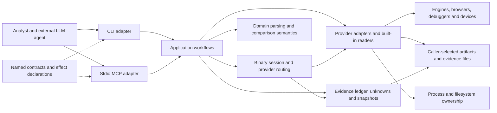
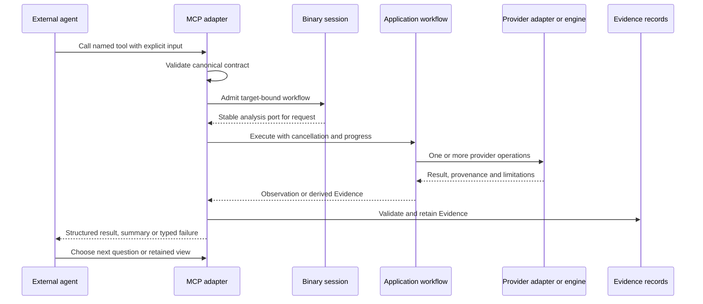
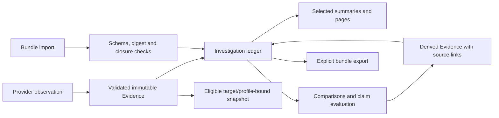

**REA architecture report — source review, 13 October 2026**

**REA is a substantial local investigation platform whose strongest architectural feature is its evidence and lifecycle model.** It combines native reverse-engineering engines, built-in artifact analysis, runtime observation, debugger control, and deterministic comparison workflows behind CLI and MCP adapters. The LLM supplies investigative judgment outside REA; the production runtime supplies validated operations and preserves the observations used to support that judgment.

This report examines `/home/tyang/rea` at Git revision `c7105d9723c835b5e0122f5fc6cfbea86265c349`. The package declares version `6.4.0`; that does not establish that every capability on this revision is in the published 6.4.0 package. The development toolchain is Node `24.18.0` and npm `11.16.0`. [Package metadata](/home/tyang/rea/package.json:1), [Node pin](/home/tyang/rea/.nvmrc:1), [documented release/source distinction](/home/tyang/rea/docs/installation.md:379).

The review traced entrypoints, public contracts, server registration, shared workflows, provider implementations, bridges, process ownership, representative tests, verification scripts, and recorded verification notes. It was a broad architectural source review, not a line-by-line audit of every parser. No source code was modified, dependencies installed, builds run, targets executed, or external analysis engines started. This checkout has no `node_modules/` or `dist/`, so no test-pass claim is made for this revision.

Evidence terminology in this report:

- **Source-confirmed:** an implementation path or explicit constraint exists in the inspected code.
- **Test-backed design:** a relevant test or verifier exists and its assertions were inspected; it was not executed during this review.
- **Recorded verification:** repository notes describe an earlier real-provider run, limited to its recorded revision, environment, and inputs.
- **Assessment:** an architectural inference from those observations.

**The overall structure is a layered TypeScript modular monolith with external analysis processes.** It is not organized as independently deployed backend services. A single npm package supplies the CLI and stdio MCP server; Java, Python, Swift, native Windows code, and external tools provide selected host or engine boundaries. The public website and documentation are separate publishing surfaces, not the investigation runtime.

The diagram shows functional relationships, not an assertion that every import follows a perfectly isolated layer. The principal ownership boundaries are:

| Area | Responsibilities and source anchors |
|---|---|
| Executable dispatch | `scripts/rea.mjs` selects MCP or CLI before loading the corresponding built runtime. MCP startup parses configuration, creates a session, installs the transport and shutdown handling. [Dispatcher](/home/tyang/rea/scripts/rea.mjs:7), [MCP entrypoint](/home/tyang/rea/src/main.ts:43). |
| CLI | Incur command registration, argument/output handling, cancellation, and one-shot invocation of shared workflows. [CLI composition](/home/tyang/rea/src/cli.ts:70), [direct analysis](/home/tyang/rea/src/application/DirectAnalysis.ts:88). |
| MCP server | Named tool registration, guided prompts and completions, request cancellation/progress, output validation and bounded delivery, provider cleanup. [Server construction](/home/tyang/rea/src/server/createServer.ts:285), [SDK wrapper](/home/tyang/rea/src/server/EvidenceMcpServer.ts:105). |
| Contracts | Zod input/output schemas, tool descriptions, examples, effects, and derived MCP annotations. The complete catalog is assembled explicitly. [Catalog](/home/tyang/rea/src/contracts/toolContracts.ts:39), [contract type](/home/tyang/rea/src/contracts/toolContractTypes.ts:45), [effects](/home/tyang/rea/src/contracts/toolEffects.ts:2). |
| Domain | Evidence identities, binary/artifact models, JavaScript semantics, managed/native metadata, comparisons, coverage, unknowns, and reconstruction claim evaluation. [Evidence](/home/tyang/rea/src/domain/evidence.ts:123), [reconstruction evaluator](/home/tyang/rea/src/domain/reconstructionVerification.ts:79). |
| Application | Composed analyses, comparison workflows, target admission, session transitions, investigation records, setup/doctor, and service-specific ports. [Analysis port](/home/tyang/rea/src/application/AnalysisProvider.ts:114), [enhanced workflows](/home/tyang/rea/src/application/EnhancedTools.ts:42), [record owner](/home/tyang/rea/src/application/investigation/InvestigationRecords.ts:26). |
| Composition | Production provider factories, environment binding, lazy provider loading, and deterministic deep-provider selection. [Binary wiring](/home/tyang/rea/src/composition/binary.ts:14), [optional provider isolation](/home/tyang/rea/src/composition/optionalObservationProviders.ts:66). |
| Providers and bridges | Engine protocol adaptation, artifact acquisition, format-specific decoding, execution, and normalization. Representative boundaries are [Ghidra](/home/tyang/rea/src/ghidra/GhidraProvider.ts:77), [Hopper](/home/tyang/rea/src/hopper/HopperProvider.ts), [IDA](/home/tyang/rea/src/ida/IdaProvider.ts), and [artifact analysis](/home/tyang/rea/src/artifacts/ArtifactProvider.ts:48). |
| Resource foundation | Owned subprocesses, deadlines, identity checks, bounded output, private workspaces, safe publication, and retryable cleanup. Windows adds native handle, DACL and Job Object support. [Process supervision](/home/tyang/rea/src/process/ProviderProcess.ts:20), [artifact resources](/home/tyang/rea/src/artifacts/ArtifactResourceScope.ts), [Windows process boundary](/home/tyang/rea/src/windows/WindowsOwnedProcess.ts). |
| Verification and distribution | Source/boundary/acceptance tests, real-tool scripts, agent evaluations, package verification and CI; authored agent instructions are packaged separately. [Test configuration](/home/tyang/rea/vitest.config.ts:140), [agent evaluation](/home/tyang/rea/src/evaluation/CodexAgentEval.ts:21), [authored skill](/home/tyang/rea/.agents/skills/reverse-engineer-anything/SKILL.md:1). |

**Layering is actively enforced, but it is selective rather than completely uniform.** The boundary checker rejects domain/contract dependencies on outer layers and blocks application/server imports from an explicit set of migrated provider roots. It also forbids application-to-composition imports. However, the MCP composition still directly constructs GDB, Rizin, Frida and Cutter managers; some application workflows use concrete filesystem/process/parser helpers. This is a pragmatic architecture with clear ownership in many areas, not a completely provider-independent application core. [Boundary rules](/home/tyang/rea/scripts/lib/module-boundaries.mjs:6), [direct manager construction](/home/tyang/rea/src/server/createServer.ts:334), [managed comparison dependencies](/home/tyang/rea/src/application/managed/ManagedMemberComparisonService.ts:21).

**MCP integration operates in both directions.** REA is an MCP server for an external agent and, for selected engines, an MCP client itself. Its production public entrypoint serves stdio. Internal IDA connections support stdio or Streamable HTTP; JEB uses Streamable HTTP. The JADX adapter uses SDK-framed stdio over an REA-owned Java process. Those downstream protocols do not turn REA's public stdio server into an HTTP service. [Transport startup](/home/tyang/rea/src/main/transport.ts), [IDA connection](/home/tyang/rea/src/ida/IdaMcpConnection.ts:9), [JEB connection](/home/tyang/rea/src/jeb/JebMcpConnection.ts:1), [JADX transport](/home/tyang/rea/src/android/JadxMcpTransport.ts:27).

| Integration | Actual connection and ownership |
|---|---|
| Hopper | Python bridge inside Hopper, with local Unix-socket communication and a provider request queue. Supports analysis plus provider-specific navigation and metadata edits. It is tied to Hopper's document/API semantics. [Python bridge](/home/tyang/rea/bridge/hopper_bridge.py), [client](/home/tyang/rea/src/hopper/HopperClient.ts), [capabilities](/home/tyang/rea/src/hopper/HopperProviderCapabilities.ts). |
| Ghidra | Headless import of a selected artifact into an ephemeral project; Java bridge uses Ghidra APIs and the decompiler. Unix sockets on supported POSIX hosts; authenticated loopback TCP for the Windows boundary. Original executable bytes are not patched. Some POSIX operations edit temporary analysis metadata; Windows P0 has no mutation authority. [Java dispatch](/home/tyang/rea/bridge/ghidra/ReaGhidraBridge.java:430), [transport](/home/tyang/rea/src/ghidra/GhidraTransport.ts), [capability restrictions](/home/tyang/rea/src/ghidra/GhidraProviderCapabilities.ts:26). |
| IDA | Adapts specific upstream MCP profiles to REA's analysis contracts. Attached GUI observations preserve the user's database; headless mode binds an owned private input/worker. Requests are a closed read-only set, although some attached queries navigate GUI views. Owned worker close uses `save: false`; upstream release and OS process termination are distinct facts. [operation adapter](/home/tyang/rea/src/ida/IdaOperationRunner.ts:87), [close implementation](/home/tyang/rea/src/ida/IdaSessionClient.ts:744), [live capabilities](/home/tyang/rea/src/ida/IdaProviderCapabilities.ts:68). |
| JADX / JEB | JADX analyzes APK snapshots through a managed headless bridge. JEB connects to a caller-started engine, discovers its advertised tools, and exposes project/unit/decompilation workflows. Neither is merely a documentation-only integration. [JADX provider](/home/tyang/rea/src/android/JadxProvider.ts), [JEB dispatch](/home/tyang/rea/src/jeb/JebProvider.ts:149). |
| Other analyzers | Explicit adapters run caller-provided tools such as objdump, Rizin, WABT, Binwalk/Unblob, TShark/capinfos, sigrok, Apktool and pwntools/pwndbg; some analysis is implemented directly in TypeScript. There is no generic runtime plugin-loading API evident in the inspected composition/catalog. [reverse-engineering composition](/home/tyang/rea/src/composition/reverseEngineering.ts), [WABT adapter](/home/tyang/rea/src/wasm/WabtArtifactProvider.ts:44), [firmware adapter](/home/tyang/rea/src/firmware/FirmwareProvider.ts:105). |

Agent integration also includes six guided MCP prompts: feature investigation, version comparison, reconstruction verification, crash tracing, unknown auditing, and bounded process capture. These render instructions for the external model; they do not launch an autonomous reasoning loop. Setup and doctor manage client registrations and packaged skill instructions. Installing the skill alone does not connect a server. [Prompt contracts](/home/tyang/rea/src/contracts/promptContracts.ts:96), [prompt renderer](/home/tyang/rea/src/server/registerPrompts.ts:100), [setup plan](/home/tyang/rea/src/application/SetupPlan.ts:242), [skill connection semantics](/home/tyang/rea/.agents/skills/reverse-engineer-anything/SKILL.md:15).

**Static analysis is broad, but each family has a different depth.** The following are source-confirmed implemented capabilities; availability still depends on host, input, engine configuration and supported profile.

| Family | Implemented scope | Important boundary |
|---|---|---|
| Native code | Symbols, strings, sections, pseudocode, assembly, function dossiers, callers/callees, xrefs, CFG-related comparisons, instruction/type inspection, memory/file mapping, selected Objective-C/Swift analysis and static call/value tracing. [EnhancedTools](/home/tyang/rea/src/application/EnhancedTools.ts), [native operations](/home/tyang/rea/src/contracts/officialToolContracts.ts). | Engine-derived results, not original source or proof of runtime reachability. Unsupported facets and indirect calls remain explicit. Different providers do not offer identical capabilities. |
| Containers and Apple resources | Inventories and extraction for directories/archives/packages, ASAR and Mach-O slices; plists, signatures, Interface Builder, keyed archives, asset catalogs and dylib-resolution analysis. [ArtifactProvider](/home/tyang/rea/src/artifacts/ArtifactProvider.ts), [native provider](/home/tyang/rea/src/native/NativeMacOSProvider.ts). | Some readers are portable; native tooling and UI facilities are host-specific. Inventory scope and extraction integrity are separate facts. |
| JavaScript / Electron | Babel-based parsing, module/import/export relationships, bundler projections, application and semantic graphs, routes/IPC/native-addon boundaries, source maps, source-to-bundle and version comparison; optional Wakaru recovery; packaged Electron fuse inspection. [JS workflow](/home/tyang/rea/src/application/javascript/JavaScriptApplicationService.ts:33), [source parser](/home/tyang/rea/src/domain/javascript/javascriptSourceParser.ts), [fuse reader](/home/tyang/rea/src/electron/ElectronFuseProvider.ts:45). | Static parsing does not execute the app. Computed/dynamic relationships, unsupported syntax and bounded analysis produce unknowns; recovery does not establish the original source tree. |
| .NET | PE/CLI identity, metadata, CIL bodies/instructions, members, calls, field access, declared native boundaries, member comparison, graph projection and importing separately obtained decompiled text. [managed reader](/home/tyang/rea/src/dotnet/ManagedStaticProvider.ts:49), [reconstruction import](/home/tyang/rea/src/application/managed/ManagedReconstructionService.ts). | The built-in path is not a general C# decompiler or managed runtime debugger. IL2CPP decoding and native body recovery are not implied. Optional NativeAOT/Ghidra analysis is a separate path. |
| Android / Flutter / Harmony | JADX APK manifest/class/method/reference analysis; Apktool resource decoding; Flutter build provenance and bounded Dart AOT structure/string observations; mobile application graph projections. [JADX](/home/tyang/rea/src/android/JadxProvider.ts), [Apktool](/home/tyang/rea/src/apktool/ApktoolProvider.ts:323), [Flutter](/home/tyang/rea/src/flutter/FlutterBuildProvider.ts:333), [mobile contracts](/home/tyang/rea/src/contracts/applicationToolContracts.ts:269). | Flutter class-like strings are not recovered typed Dart classes/functions. Platform graph projection is not complete native/runtime semantics. |
| Go / Rust | Embedded Go compiler/module/build information and Rust cargo-auditable dependency metadata, with ELF/PE/thin Mach-O readers. [Go](/home/tyang/rea/src/go/GoBinaryProvider.ts), [Rust](/home/tyang/rea/src/rust/RustBinaryProvider.ts). | Metadata inspection; absent metadata does not establish language or dependency absence. |
| WASM / EVM | WABT validation, sections, import/export forms and WAT; WASM interface comparisons; EVMole selector/interface inference and bytecode metadata. [WABT](/home/tyang/rea/src/wasm/WabtArtifactProvider.ts), [EVMole](/home/tyang/rea/src/evm/EvmoleInterfaceProvider.ts:67). | No WASM application execution, blockchain query, transaction execution, or guaranteed original ABI recovery. The admitted EVM profile is Linux x64. |
| Firmware | Binwalk region identification, Unblob extraction, normalized results and artifact/native handoffs. [FirmwareProvider](/home/tyang/rea/src/firmware/FirmwareProvider.ts:105). | Extraction and downstream analysis, not a general firmware emulator or protection-recovery workflow. |
| Recordings / databases | HAR/SAZ/mitmproxy/specific qlog ingestion; packet fields and packet summaries; sigrok recordings; SQLite schema and selected rows; recorded ELF crashes with optional debugger-backed interpretation. [capture decoder](/home/tyang/rea/src/browser/history/HistoricalCaptureDecoder.ts), [TShark](/home/tyang/rea/src/captures/TsharkCaptureProvider.ts:68), [PCAP](/home/tyang/rea/src/pcap/PcapProvider.ts:70), [sigrok](/home/tyang/rea/src/signals/SigrokRecordingProvider.ts:67), [SQLite](/home/tyang/rea/src/sqlite/SqliteDatabaseProvider.ts:53), [crash service](/home/tyang/rea/src/application/binaryDiagnostics/RecordedCrashService.ts). | These inspect supplied recordings/snapshots. They do not establish complete network history, perform live packet acquisition, or imply that all possible records were observed. |

**Dynamic analysis and debugging are implemented, with materially different authority across tools.** “Local-only” describes where REA runs and keeps its analysis; it is not a universal no-network or sandbox guarantee.

| Surface | Implemented behavior and limits |
|---|---|
| Process scenarios | Launch a selected command under a PTY; drive input and conditions; retain terminal, exit, process and optional filesystem observations; compare captures with explicit trace semantics. The child runs with the user's permissions. Sampling is not complete syscall tracing. [ProcessHarness](/home/tyang/rea/src/process/capture/ProcessHarness.ts:257), [scenario contract](/home/tyang/rea/src/contracts/sessionToolContracts.ts), [process comparisons](/home/tyang/rea/src/domain/process/processComparison.ts). |
| Browser capture | CDP inspection of selected pages, scripts, network observations and screenshots; Playwright scenarios can navigate, click and type. Runtime attribution uses precise coverage and request initiators; coverage instrumentation resets counters and affects optimization. [CDP provider](/home/tyang/rea/src/browser/CdpBrowserProvider.ts:79), [scenario provider](/home/tyang/rea/src/browser/PlaywrightBrowserScenarioProvider.ts:341), [coverage capture](/home/tyang/rea/src/browser/execution/CdpExecutionCapture.ts). |
| JavaScript runtime / Electron | Passive V8 Inspector discovery and script observation; passive Electron inspection; a separate active Electron launch/action workflow with hooks. The passive V8 provider sends Runtime/Debugger enable requests and does not expose a general evaluate/resume debugger. [V8 provider](/home/tyang/rea/src/inspector/V8InspectorProvider.ts:79), [active Electron provider](/home/tyang/rea/src/browser/PlaywrightElectronActiveProvider.ts:58). |
| GDB | Persistent Linux sessions using MI framing and unrestricted console commands. Commands can inspect or modify memory/registers, control execution, run shell commands and affect files/network through GDB. Cleanup distinguishes debugger ownership from inferior ownership and validates a durable TTY before automatic detach. [manager](/home/tyang/rea/src/gdb/GdbSessionManager.ts:363), [public contract](/home/tyang/rea/src/contracts/gdbToolContracts.ts:26). |
| Rizin / Cutter | One-shot Rizin commands, persistent Linux Rizin debug sessions, and arbitrary commands in a selected live Cutter bridge. Plugin effects and command effects are intentionally broad. Persistent Rizin detach checks `dbg.exitkills=false`, descriptors and the selected TTY. [debug manager](/home/tyang/rea/src/rizin/RizinDebugSessionManager.ts:281), [Cutter service](/home/tyang/rea/src/cutter/CutterBridgeService.ts), [command contracts](/home/tyang/rea/src/contracts/reverseEngineeringToolContracts.ts:47). |
| Frida | Local/remote device and process discovery; attach or paused spawn; caller-authored JavaScript injection; resume, unload, status and detach; one-shot CLI/MCP instrumentation. Scripts can change target behavior. Cleanup resumes an owned still-paused spawn and detaches; it does not kill the target. [manager](/home/tyang/rea/src/frida/FridaInstrumentationManager.ts:261), [contract](/home/tyang/rea/src/contracts/fridaToolContracts.ts:115). |
| macOS native runtime/UI | Accessibility/UI observation and scenario control; LLDB launches a Mach-O target and records selected call entries. Call tracing captures integer argument registers and limited runtime facts, not return values or all argument conventions. It is bounded instrumentation, not a general persistent LLDB console. [native call boundary](/home/tyang/rea/src/native/NativeCallObservation.ts:29), [LLDB implementation](/home/tyang/rea/src/native/LldbCallTracer.ts), [UI implementation](/home/tyang/rea/src/native/NativeUiObservation.ts). |
| Android devices | ADB inventory, packages/processes, logs/dumps, screen and file acquisition, plus explicit transfer/install/uninstall/start/stop operations. This includes device mutation and application execution. [ADB provider](/home/tyang/rea/src/adb/AdbProvider.ts), [public contracts](/home/tyang/rea/src/contracts/adb/adbToolContracts.ts). |

There is no single universal debugger abstraction across these surfaces. GDB/MI, Rizin framing, Frida sessions, LLDB tracing, CDP instrumentation and process scenarios retain their own semantics. Shared supervision and Evidence connect them. Broad-command tools also preserve uncertainty: a timeout can mean the command's completion is unknown, and launch provenance does not establish the debugger's current target after arbitrary commands.

**Decision-making is divided between the external agent, deterministic REA workflows, and upstream engines.** I found no production model inference client or autonomous LLM planning loop in the inspected runtime. The evaluation code invokes or evaluates external agents, which is a separate testing concern. REA exposes no implemented MCP sampling-based reasoning loop; its runtime identity explicitly reports elicitation as unsupported. [server identity](/home/tyang/rea/src/serverIdentity.ts:78), [client requirements](/home/tyang/rea/src/application/CapabilityClientRequirements.ts:3), [agent verifier](/home/tyang/rea/scripts/verify-agent-experience.mjs:34).

| Decision | Owner |
|---|---|
| What behavior matters; which hypotheses to investigate; next tool/target/query; how to interpret and explain findings | External analyst/LLM, guided by schemas, prompts, skill instructions and prior Evidence. |
| Target parsing; admissible provider; schema validation; resource policy; cleanup; comparison compatibility and unknown propagation | Hardcoded REA code. |
| Feature tracing | A fixed literal search over strings/procedures followed by xrefs and containing-procedure resolution. It is not natural-language feature understanding inside REA. [literal tracer](/home/tyang/rea/src/application/EnhancedLiteralTracing.ts:38). |
| Call-path exploration | Deterministic traversal of provider relationships, retaining coverage gaps and failures. [call-path tracer](/home/tyang/rea/src/application/CallPathTracing.ts:30). |
| Decompilation, auto-analysis, type recovery | Primarily the selected upstream engine; REA adapts and attributes its observations. |
| Static/runtime correlation | Caller-supplied explicit mappings and hypotheses are evaluated by fixed rules. Similar names and cochange do not establish causality. [correlation schema/evaluator](/home/tyang/rea/src/domain/staticRuntimeCorrelation.ts:65). |
| Reconstruction verification | Evaluates declared claims against supplied comparison Evidence and unknowns. Passing means those claims passed, not global implementation equivalence. Code writing and experiment selection remain external activities. [verification semantics](/home/tyang/rea/src/domain/reconstructionVerification.ts:79). |

**Tool execution is contract-driven and generally follows a reusable admission–execution–evidence path.** The source effect inventory contains 207 named entries. A test requires exact equality with the public contract names; this is a source inventory count, not a live catalog measurement from this checkout. [inventory](/home/tyang/rea/src/contracts/toolEffects.ts:69), [equality assertion](/home/tyang/rea/src/contracts/toolEffects.test.ts:101).

Target-free operations use their explicit file/endpoint and do not require opening a native binary. Other operations run through `BinarySession`. The session serializes target transitions, drains admitted work before changing targets, and tracks failed cleanup for retry. Composed calls use admission across the whole workflow so a target cannot change between constituent observations. [shared handler](/home/tyang/rea/src/server/contractToolHandler.ts:46), [session admission](/home/tyang/rea/src/application/binary/BinarySession.ts:653).

Deep-provider choice is deterministic: an explicit request or configuration selects a provider; automatic selection requires exactly one usable candidate. Multiple candidates produce ambiguity rather than priority based on registration order. No usable deep provider can leave the deep family unbound while auxiliary capabilities remain available. `CompositeProvider` maps disjoint operation names and creates children lazily; it rejects overlapping declarations. This is explicit routing, not automatic fallback through every engine. [selection](/home/tyang/rea/src/application/binary/AnalysisProviderRegistry.ts:75), [automatic ambiguity](/home/tyang/rea/src/application/binary/AnalysisProviderRegistry.ts), [composite routing](/home/tyang/rea/src/application/binary/CompositeProvider.ts:28).

The adapters share workflows but have different lifetimes. CLI native analysis opens, runs, and closes a session per invocation; persistent debugger facilities have one-shot CLI wrappers. MCP retains its session, engines, debugger IDs and Evidence across calls. Snapshot files provide explicitly validated reuse for suitable analyses. Public `close_binary` clears investigation records; export and snapshot operations provide persistence. Failed open paths preserve investigation history. [CLI lifetime](/home/tyang/rea/src/application/DirectAnalysis.ts:88), [CLI debugger wiring](/home/tyang/rea/src/cli/reverseEngineeringCommands.ts:94), [close semantics](/home/tyang/rea/src/application/binary/BinarySession.ts:473).

**Evidence is a first-class domain object, not just a formatted tool response.** It records subject digest/path/format, provider identity, optional committed analysis profile, operation parameters, normalized and distinct raw results, observed/derived/inferred confidence, authority, environment, limitations, locations and links. A canonical semantic digest supplies the Evidence ID. Import validates that the content matches the ID and merges records atomically. These hashes establish content consistency, not an independent signature proving that a provider's claims are true. [Evidence schema](/home/tyang/rea/src/domain/evidence.ts:123), [identity calculation](/home/tyang/rea/src/domain/evidence.ts:225), [ledger](/home/tyang/rea/src/application/investigation/EvidenceLedger.ts:43).

Snapshot eligibility excludes live/UI-dependent operations and mutations. Keys bind target/profile/query facts; metadata mutation invalidates replay. IDA observations explicitly use a live cache policy because original-input identity does not prove that an attached database is unchanged. The snapshot cache has a 10,000-entry ceiling. The separate Evidence ledger stores distinct records/revisions in Maps; I found no aggregate byte ceiling at that owner, so bounded individual operations do not establish a fixed bound for a long investigation's retained memory. [snapshot policy](/home/tyang/rea/src/application/binary/AnalysisSnapshotCache.ts:43), [IDA policy](/home/tyang/rea/src/ida/IdaProviderCapabilities.ts:86), [ledger retention](/home/tyang/rea/src/application/investigation/EvidenceLedger.ts:43).

Successful evidence-producing MCP tools usually return matching text and structured content. Summary-capable paths can retain complete source Evidence and return a linked view; `inspect_analysis_view` pages supported retained data without rerunning its provider. Oversized responses produce an explicit delivery constraint and recovery reference rather than silently relabeling truncated output as complete. Error results have `isError: true` and JSON text diagnostics; the transport removes error `structuredContent` because advertised output schemas describe success. [delivery](/home/tyang/rea/src/server/toolResult.ts:49), [transport handling](/home/tyang/rea/src/server/EvidenceMcpServer.ts:301), [views](/home/tyang/rea/src/application/analysisView/AnalysisViewService.ts).

Compact input-schema advertisement and optional omission of advertised output schemas address client/catalog limits while retaining canonical validation. Full schemas remain the default. Tool effects are converted into MCP hints, and target-derived content is marked untrusted. Those hints and markers inform clients; they do not constitute a general execution sandbox or guaranteed prompt-injection defense. WebMCP discovery observes page-declared tools but never registers or invokes them. [schema profiles](/home/tyang/rea/src/config/mcpInputSchemaProfile.ts), [output profile](/home/tyang/rea/src/config/mcpOutputSchemaProfile.ts), [untrusted-content instructions](/home/tyang/rea/src/server/createServer.ts:139), [WebMCP boundary](/home/tyang/rea/src/browser/CdpWebMcpDiscovery.ts:44).

**Implementation and verification maturity are substantial but uneven across capability families.** The checkout contains 1,233 TypeScript `*.test.ts` files across `src/` and `tests/`; production-oriented `src/` files excluding `.test.` and `.fixture.` files account for approximately 289,000 lines. These are filesystem counts, not coverage measurements or a claim that every test passes.

The test architecture includes domain/service/adapter tests, composition tests, real CLI subprocess acceptance, SDK MCP boundary tests, producer fixtures, and separate real-tool verification scripts. Schema tests use the actual MCP SDK conversion and Ajv's JSON Schema 2020-12 validation. Tests explicitly cover cancellation, partial results, cleanup retries, identity drift, malformed input and optional-provider isolation. [schema validation](/home/tyang/rea/tests/boundary/mcp/toolSchemaValidity.test.ts:1), [CLI parser acceptance](/home/tyang/rea/tests/acceptance/managedCliOutput.test.ts:1), [optional-provider startup coverage](/home/tyang/rea/tests/boundary/mcp/optionalProviderIsolation.test.ts:1), [module-boundary tests](/home/tyang/rea/tests/evaluation/moduleBoundaries.test.ts:1).

| Evidence available in the repository | What it establishes—and what remains unverified here |
|---|---|
| Ghidra MCP harness and provider fixtures | Exercise REA routing, schemas and semantics with injected results. They do not prove actual Ghidra behavior. [harness](/home/tyang/rea/tests/boundary/mcp/ghidraMcpHarness.ts:27). |
| Real Ghidra verification scripts | Run actual headless analysis, compare observations and check cleanup; architecture and Windows lanes are separate. Their presence does not prove a successful run at this HEAD. [real verifier](/home/tyang/rea/scripts/verify-real-ghidra.mjs:43), [Windows workflow](/home/tyang/rea/.github/workflows/real-ghidra-windows.yml:54). |
| IDA recorded Windows/native and headless notes | Describe real CLI/MCP checks on specific IDA/plugin builds, including positive-oracle verification. The Windows native run used a plugin with a local listener change; it does not establish every stock plugin/version/host combination. [recorded Windows results](/home/tyang/rea/experiments/analysis-efficiency/ida-native-windows.md:1), [documented coverage limits](/home/tyang/rea/docs/ida-provider.md:156). |
| Frida verifier | A real service/provider script checks a spawned Node target or explicit remote PID, an injected message and cleanup. It does not by itself verify every public CLI/MCP persistent-session path or platform. [verifier](/home/tyang/rea/scripts/verify-frida.mjs:1). |
| GDB/Rizin boundary tests | Include fake processes to exercise framing, cancellation and target disposition. These are meaningful boundary tests, not proof of all actual debugger/backend combinations. [GDB fixture tests](/home/tyang/rea/tests/boundary/providers/GdbSessionManagers.test.ts:1), [Rizin tests](/home/tyang/rea/tests/boundary/providers/RizinDebugSessionManagers.test.ts:1). |
| Managed/readiness conformance | Source-owned fixtures exercise parsers, public workflows, evidence integrity and declared reconstruction rules. The nine-stage readiness evaluator is internal verification machinery, not a general public autonomous reconstruction tool. Generated managed completion artifacts are ignored outputs and absent from this checkout. [readiness scope](/home/tyang/rea/docs/reconstruction-readiness.md:1), [ledger generator](/home/tyang/rea/scripts/generate-completion-ledger.mjs:15). |
| Agent evaluations | Measure routing, calls, token usage, text heuristics and selected known-answer fixtures. The implementation explicitly says free-form factual correctness is not assessed generally. [metric limitations](/home/tyang/rea/src/evaluation/CodexAgentEval.ts:21). |
| CI and real-engine workflows | Substantial automated qualification exists, including source/built tests and platform/provider lanes. Some licensed or host-dependent engine workflows are manual/self-hosted. This review did not query run status, download receipts or reproduce them. [CI](/home/tyang/rea/.github/workflows/ci.yml), [Hopper workflow](/home/tyang/rea/.github/workflows/real-hopper.yml), [testing policy](/home/tyang/rea/docs/testing.md:246). |

**The main documentation differences are scope differences, with one clear source-description inconsistency.** Most detailed guides are more conservative than the product's “reverse engineer anything” wording.

- **Current source versus released package:** package version `6.4.0` is insufficient to identify capability availability. The installation guide explicitly records a published-release checkpoint and newer source-only functionality. No current npm-registry state was independently checked here. [release distinction](/home/tyang/rea/docs/installation.md:379).
- **Shared CLI/MCP workflows versus identical interfaces:** the shared application core is real, but persistent MCP sessions and one-shot CLI commands have different lifetimes and sometimes different delivery choices. This is an intentional distinction, not a parity defect.
- **Flutter/Dart AOT versus decompilation:** the implementation explicitly describes identifier-shaped strings and supported snapshot structure; typed class/function recovery requires an SDK-specific parser. [implementation limits](/home/tyang/rea/src/flutter/FlutterBuildProvider.ts:1094).
- **Managed reconstruction versus built-in source recovery:** managed inspection parses metadata/CIL; reconstruction import associates externally supplied decompiled material with identities. NativeAOT and IL2CPP are not interchangeable with this path. [managed scope](/home/tyang/rea/docs/managed-code-analysis.md:77).
- **JEB project opening versus engine availability:** the guide records that JEB 5.48.0 headless does not advertise `open_project`; REA cannot supply an engine operation absent from discovery. This is an upstream-profile limitation acknowledged by the adapter/guide. [JEB coverage](/home/tyang/rea/docs/jeb-analysis.md:26), [engine operation dispatch](/home/tyang/rea/src/jeb/JebProvider.ts:274).
- **Native load-image tool description is stale:** its canonical description says DOS MZ/COM and “other formats return unsupported,” while the source includes raw-binary attestation and the raw-binary guide gives public CLI examples. The raw path is therefore implemented and documented elsewhere but underdescribed in the agent-facing contract. [description](/home/tyang/rea/src/contracts/officialToolContracts.ts:47), [raw implementation](/home/tyang/rea/src/ghidra/GhidraLoadImageValues.ts:333), [public example](/home/tyang/rea/docs/raw-binary.md:12).
- **Declared support versus verification:** Windows Ghidra P0 is explicitly experimental and constrained to selected native PE/raw-6502 cases, matching native controls and local NTFS requirements. Ghidra also refuses unthinned universal Mach-O input. IDA native/headless profiles lack direct callers when upstream xrefs cannot prove call edges. These are encoded limitations, not missing generic wrappers. [Windows restrictions](/home/tyang/rea/src/ghidra/GhidraProviderCapabilities.ts:33), [target admission](/home/tyang/rea/src/ghidra/GhidraProvider.ts:161), [IDA facet availability](/home/tyang/rea/src/ida/IdaProviderCapabilities.ts:74).

**My maturity assessment is “advanced, actively evolving specialist platform with production-oriented engineering and uneven provider qualification.”** This is an assessment of the repository, not a certification of operational reliability on untested targets.

| Dimension | Assessment |
|---|---|
| Core architecture | Strong ownership concepts, typed contracts, explicit composition, provider attribution and shared workflows. Selective layering and some large managers make it less uniform than the high-level architecture diagram suggests. |
| Evidence correctness | A major strength: canonical identity, immutable records, source links, explicit unknowns, partial observations, comparison preconditions and replay invalidation are implemented structures rather than prose conventions. |
| Runtime lifecycle | Unusually substantial handling of process identity, ownership, cancellation, inferior disposition and cleanup failure retention. It remains host- and provider-specific; unrestricted tools execute with meaningful authority. |
| Breadth | Extensive and implemented across many formats. Depth ranges from metadata triage to decompilation and interactive debugging; breadth must not be read as universal semantic recovery. |
| Verification | Large and thoughtfully stratified test/verifier surface. Actual qualification is narrower than source coverage and cannot be inferred from fixture tests, schema validity or a verifier's existence. No current run was performed. |
| Agent usability and cost | Focused workflows, retained views and schema profiles show serious attention to agent efficiency. The broad catalog and dual text/structured results can still be expensive, and extra paging calls can negate smaller responses. |
| Extensibility | New families are wired explicitly through contracts, registration, composition and adapters. This offers auditability but entails repository integration work; a general external plugin SDK is not an implemented extension boundary in this review. |
| Operational limits | Bring-your-own licensed/toolchain prerequisites, platform gates, snapshot lifetime, large retained evidence and provider protocol versions remain material constraints. |

Historical performance notes support a nuanced assessment rather than a general speed claim. The recorded Windows IDA experiment improved a warm task while not establishing fresh-start, aggregate CPU or memory improvements; its full catalog estimate was large. The current HEAD's small-PCAP experiment records a negative case for summary-plus-page delivery. These are scoped historical measurements, not measurements made by this architectural review. [IDA measurements](/home/tyang/rea/experiments/analysis-efficiency/ida-native-windows.md), [small-PCAP measurements](/home/tyang/rea/experiments/analysis-efficiency/pcap-small-captures.md).

**The documented roadmap emphasizes verification and connecting existing capabilities.** Its priorities are broader native architecture/type/indirect-call verification; joining static and runtime findings across application layers; stronger obfuscated managed comparisons and verified native links; process/protocol/filesystem/reconnect/build-comparison coverage; and additional providers where a concrete analyst workflow reveals a gap. It supplies priorities, not a dated release schedule. Historical efficiency notes explicitly defer plugin SDKs and cross-session engine caches pending demonstrated need; that note is not evidence of a committed delivery date. [roadmap](/home/tyang/rea/docs/roadmap.md:9), [deferred work note](/home/tyang/rea/experiments/analysis-efficiency/latest-main-audit.md:17).

Integration scope also constrains that roadmap: the contribution policy excludes dedicated commercial protection defeat, anti-debugging evasion and attack automation, and requires explicit scope decisions for new execution/injection/mutation capabilities. These are project admission rules; they do not themselves sandbox an existing GDB, Rizin or Frida call. [contribution scope](/home/tyang/rea/CONTRIBUTING.md:28).

The unresolved facts after this review are current test/CI outcomes, availability and versions of engines on the user's host, real-provider correctness at this exact commit, unrecorded platform/format combinations, and generalization from finite fixtures to arbitrary targets. No implementation changes or new feature proposals are included in this report.
